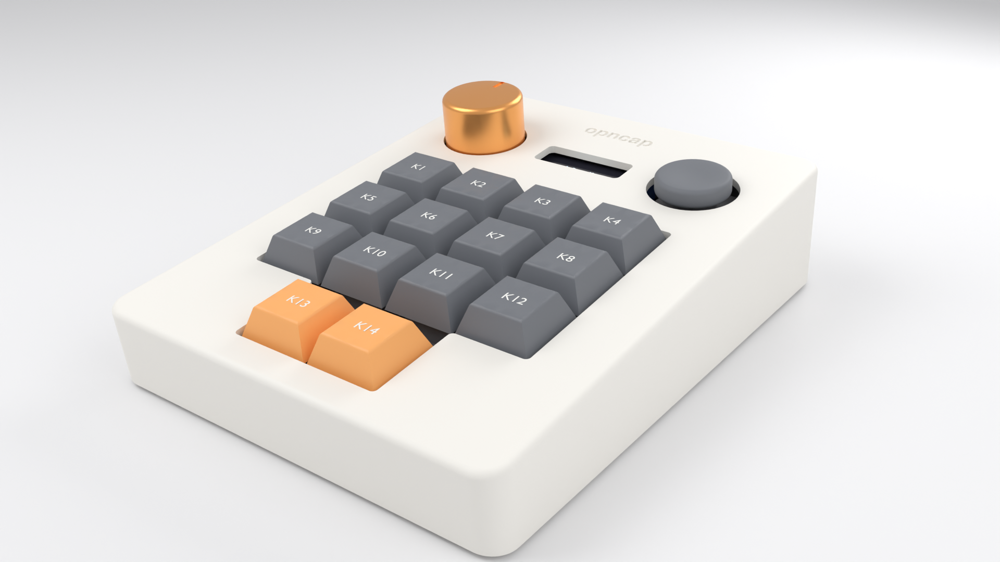

<!-- SPDX-License-Identifier: Apache-2.0 -->
# opncap

Open-source macropad: 14 MX hotswap keys, rotary encoder, Hall-effect joystick, OLED, per-key RGB and underglow. Wired first (phase 1), BLE later.

**Status:** planning and generated hardware design. Nothing is ordered or tested on real hardware.

| Path | Content |
|---|---|
| `spec.md` | Specification |
| `features.md` | Feature descriptions and user flows |
| `docs/` | Generated documentation (`pinout.md`) |
| `hardware/` | PCB, fabrication files, enclosure, renders and the scripts that generate them. Start with `hardware/README.md`. |
| `hardware/bom.md` | Bill of materials (source of truth for parts) |
| `hardware/pinout.yaml` | Pin assignment (source of truth) |

Regenerate the hardware files with `make hardware` (see `hardware/README.md` for the tools needed).

